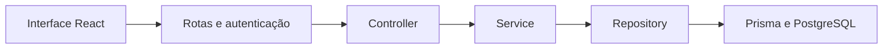

# Arquitetura do projeto

O projeto é um monólito modular: uma API Express com módulos por assunto e uma interface React separada. O fluxo de uma operação é:

## Responsabilidades

| Camada | Responsabilidade | Exemplo |
| --- | --- | --- |
| Rotas / composição | Registrar URL, verbo, autenticação e perfil exigido | `src/app.ts`, `src/academico/routes.ts` |
| Controller | Ler e validar o contrato HTTP, chamar o serviço e definir status/resposta | `src/academico/controller.ts` |
| Service | Aplicar regras, conferir acesso ao recurso, coordenar transações e montar os dados públicos | `src/academico/service.ts` |
| Repository | Consultas Prisma, SQL, projeções, gravações e bloqueios de linha | `src/academico/repository.ts` |
| Infraestrutura | Conexão e unidade de transação | `src/lib/prisma.ts`, `src/lib/transaction.ts` |
| Banco | Chaves estrangeiras, restrições, unicidade e isolamento transacional | `prisma/schema.prisma`, migrations |

Os módulos são `auth`, `usuarios`, `imports`, `academico` e `registros`. As consultas maiores ficam em `query-service.ts` e `query-repository.ts`. Aprovações possuem um serviço próprio; o SQL de horas do currículo fica em `course-hours-repository.ts` e o cálculo do resumo permanece no serviço `course-hours.ts`.

As funções de repositório têm nomes de operações, como `activeEnrollment`, `lockGroupRow` e `insertRecord`. Não devolvem o client Prisma para os controllers. A infraestrutura ainda usa tipos Prisma em contratos de persistência e na unidade de transação: esta é uma separação prática de responsabilidades, não uma promessa de independência completa do ORM. Não há camada de interfaces duplicando cada função sem necessidade.

## Quem decide

Um aluno disponível na tela não está automaticamente autorizado a entrar no grupo. A API consulta elegibilidade e, no momento da gravação, o serviço verifica novamente matrícula ativa, turma, conta e grupo, sob os bloqueios existentes. Mudanças entre consulta e confirmação não contornam a regra.

Da mesma forma, a aprovação confere perfil, professora responsável, instituição, ficha, estado, versão e lote no backend. Os serviços mantêm a ordem de bloqueio aluno → grupo → vínculo, as transações e os snapshots históricos. Os repositórios executam as operações dentro da mesma transação; não abrem uma transação independente por gravação.

O middleware de autenticação identifica a sessão antes do controller, consultando o repositório de autenticação. O perfil e a instituição vêm da sessão validada; não são aceitos como autoridade no corpo da requisição. Filtros de acesso são reaplicados nas consultas. O banco continua validando as relações, mesmo quando RLS pode ser contornado pela conexão administrativa.

## O que fica no navegador

O React controla campos, modal aberto, carregamento, mensagens, foco, confirmação e navegação. Pode formatar uma data, desenhar o anel de progresso e mostrar uma estimativa de duração. Essas operações servem para apresentação e não definem o valor persistido nem concedem permissões.

A busca e a paginação de pessoas passaram ao backend. A coordenação não baixa mais todos os usuários e matrículas para filtrar alunos elegíveis. O detalhe consulta a pessoa pelo ID; cada turma recebe sua contagem de matrículas da API. Professoras e alunos disponíveis são consultados em páginas. Catálogos de referência e a consulta visual de grupos ainda usam as listagens existentes; filtros visuais dessas listas não autorizam nenhuma operação.

Os controles podem ser desabilitados por conveniência, mas toda operação continua validada se alguém modificar o JavaScript ou chamar a API diretamente. Validação de formulário no cliente não substitui a validação Zod e as regras dos serviços.

## Contratos acrescentados

- `GET /usuarios?pagina=1&busca=texto&perfil=aluno&cadastros=1&ativo=true`: busca por nome/e-mail, perfil e situação. Retorna até 50 pessoas e `total`. `cadastros=1` exclui coordenação da lista de alunos/professoras. Filtros são opcionais; o contrato anterior permanece disponível.
- `GET /usuarios/:id`: dados públicos e matrícula ativa de uma pessoa da instituição. Nunca inclui hash, versão de sessão ou tokens.
- `GET /academico/estagios/:id/alunos-elegiveis?pagina=1&busca=nome`: somente coordenação; retorna alunos ativos da turma, sem vínculo ativo naquele grupo. Grupo externo retorna 404; grupo encerrado retorna 409.
- `GET /academico/turmas`: inclui `alunosMatriculados`, calculado no servidor.

Buscas têm limite de 100 caracteres, e os parâmetros de página e perfil são validados. Os novos endpoints mantêm autenticação e `Cache-Control: no-store`.

## Configuração e segredos

O `.env` do backend contém segredos e permanece ignorado pelo Git. A interface chama `/api`; não recebe a URL do banco nem a chave de assinatura JWT. O token da sessão permanece em memória. Variáveis `VITE_` são públicas e devem conter somente configuração pública, como nome e logo.

`web/.env.local`, certificados e arquivos locais de identidade continuam ignorados. O `.gitignore` evita inclusão acidental de arquivos, mas não elimina credenciais já compartilhadas fora do repositório. Em produção, o segredo deve ser configurado somente no ambiente do servidor.

## Verificações

`tests/architecture.test.ts` verifica que controllers não importam repositories e que controllers/serviços não executam consultas nem importam o client de conexão. Também confere que o frontend não importa persistência ou credenciais do backend. Esses testes complementam as integrações reais; não substituem revisão de código.

Os testes de API cobrem autenticação, autorização, isolamento entre instituições, busca/paginação, matrícula, vínculos, CSV, conflitos de versão, concorrência, aprovações, reabertura e carga horária. Usam exclusivamente banco temporário local. Não há alteração de schema ou migração nesta refatoração.
