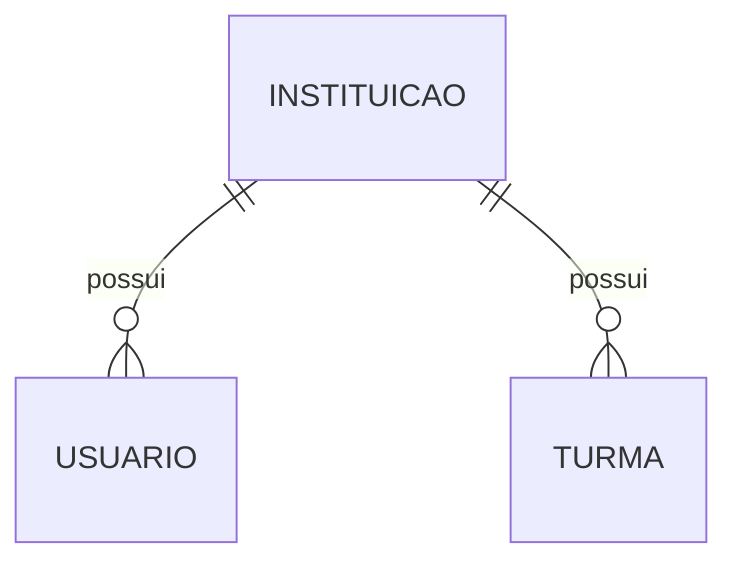

# Base do banco de dados

## Relações

- `Instituicao`: identifica a escola. Nesta fase não existe gestão de várias escolas, mas os cadastros já pertencem a uma instituição.
- `Usuario`: nome, e-mail único, hash de senha, perfil e COREN opcional. O enum aceita `aluno`, `professora` ou `coordenacao`; cada conta tem um perfil nesta versão. `ativo` bloqueia o acesso sem excluir o histórico. `tokenVersao` invalida sessões anteriores no logout e em mudanças de ativação. `criadoPorId` identifica a coordenação que fez o cadastro pela API.
- `ConviteUsuario`: guarda somente o hash do token, destinatário, criador, validade, uso e revogação. O hash de senha do usuário fica nulo até o aceite. Convites não são listados nas rotas de usuários.
- `Turma`: código único dentro de uma instituição. O mesmo código pode existir em instituições diferentes.
- `ImportacaoAlunos`: guarda temporariamente os nomes e e-mails de uma prévia validada, junto com a instituição, coordenação criadora, quantidade e validade de 30 minutos. A confirmação cria os alunos e convites em uma transação e apaga os dados pessoais da prévia, preservando os metadados. A tabela tem RLS sem políticas e um CHECK SQL que limita a quantidade de 1 a 100. Veja [importação de alunos](student-import.md) para limpeza de dados expirados e regras de confirmação.

Não colocamos `turmaId` em todo usuário: professoras e coordenação não pertencem a uma única turma como um aluno. O histórico de turmas fica em `MatriculaTurma`. `Disciplina` define a carga horária, `CampoEstagio` representa o local, `Estagio` representa um grupo com professora e `VinculoEstagio` registra a participação do aluno. Consulte [cadastros acadêmicos](academic.md) para as restrições e rotas.

## Como ler o schema

`@id` define a chave primária. `@default(uuid())` faz o Prisma gerar um identificador; inserções por SQL precisam fornecer esse ID. `@db.Uuid` escolhe o tipo nativo UUID do PostgreSQL.

`instituicaoId` é a chave estrangeira. A relação impede cadastrar usuário ou turma para uma escola inexistente. `onDelete: Restrict` impede apagar uma instituição enquanto ela tiver esses cadastros.

`@unique` protege o e-mail contra duplicação no banco. A autenticação normaliza os e-mails com remoção de espaços nas pontas e conversão para minúsculas. A migration de autenticação inclui um CHECK SQL que exige e-mails em minúsculas e sem espaços nas pontas. Esse CHECK é mantido no SQL, pois não é representado no schema do Prisma.

`@@unique([instituicaoId, codigo])` protege a combinação dos dois campos. O índice também ajuda nas consultas de turmas por instituição. Usuários possuem um índice separado para essa busca.

`@map` e `@@map` permitem usar `senhaHash` e `Usuario` no TypeScript, mantendo `senha_hash` e `usuario` no PostgreSQL.

`criadoEm` recebe a data do banco. `atualizadoEm` é atualizado pelo Prisma; alterações feitas diretamente por SQL precisam informar esse campo. Ambos usam timestamps com fuso horário.

## Configuração, client e migration

- `prisma/schema.prisma` descreve os modelos e o destino do client gerado. Não contém credenciais.
- `prisma.config.ts` carrega o `.env`, indica schema, migrations e seed e usa `DIRECT_URL` para a CLI. Sem essa URL, comandos que precisam se conectar ao banco falham; geração e validação continuam disponíveis.
- `src/lib/prisma.ts` cria um único client por processo com `@prisma/adapter-pg` e `DATABASE_URL`. O pool tem limite de cinco conexões por processo; esse limite deverá ser revisto conforme o número de instâncias da API.
- `prisma/migrations/.../migration.sql` cria as tabelas, índices, relações e habilita RLS em uma transação. Uma falha faz a transação ser revertida.
- `prisma/seed.ts` usa uma transação e `upsert` para criar os dados fictícios sem duplicação. Não altera dados existentes em uma segunda execução.

Migrations são o histórico da estrutura do banco. Não edite uma migration depois que ela for aplicada em um ambiente compartilhado; crie outra para corrigir ou evoluir a estrutura.

RLS sem políticas bloqueia os papéis comuns da Data API. Isso não substitui as verificações de acesso da aplicação, especialmente quando a conexão PostgreSQL usa um proprietário ou papel com `BYPASSRLS`.

## Regras levantadas para etapas futuras

- Aluno edita rascunhos e registros devolvidos.
- Professora reabre um registro aprovado com motivo; a aprovação anterior permanece no histórico e deixa de contar como aprovação válida.
- Aprovação em lote admite de um a cinco registros, provisoriamente.
- Ficha fechada não pode ser editada no MVP.
- Campo de estágio representa o local, como um hospital. Trocas de setor no mesmo hospital não criam outro campo.
- Precisamos confirmar se uma mesma disciplina pode ocorrer em vários locais e como sua carga é distribuída.
- Horários programados não eliminam a necessidade de impedir duplicação e sobreposição de registros. A regra exata sobre excedentes ainda precisa ser confirmada.
- Os formulários indicam nove critérios e média mínima 7,0; precisão, arredondamento e regra vigente devem ser confirmados antes da fase 2.

Essas regras ainda não estão implementadas nesta migration. Os documentos escolares e dados pessoais não pertencem ao repositório.
